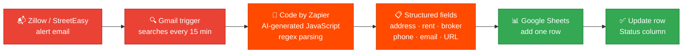

# 🏠 Real Estate Lead Tracking & Listing Alert Automation

**One listing email in. One clean row in Google Sheets. No refreshing, no missed leads.**

## What it does in 10 seconds

Zillow and StreetEasy send listing alerts by email. This Zapier pipeline catches each alert in Gmail, pulls the address, rent, broker, phone, email, and listing link out of it with AI-generated JavaScript (regex pattern-matching, not a live AI call), and logs it as one row in Google Sheets with a status. No dashboard to refresh, no lead lost in the inbox.

## How it flows

## The pipeline at a glance

| Step | Tool | What happens | Output |
| --- | --- | --- | --- |
| 1. Trigger | Gmail | Watches for Zillow / StreetEasy alert emails by sender search, polls every 15 min | Matching email fires the Zap |
| 2. Parse | Code by Zapier | AI-generated JavaScript extracts fields from subject + body with regex | Clean, structured listing data |
| 3. Log | Google Sheets | Adds one row per alert | Row in the tracker sheet |
| 4. Status | Google Sheets | Updates the new row's Status column | Row marked with its status |

Dedup is not a Zap step. It runs in the sheet — see `dedup.gs`.

## What lands in the Sheet

Mock data, showing the real columns and shape:

| Date Contacted | Property Address | Rent Amount | Source | Broker Name & Contact | Listing URL | Status |
| --- | --- | --- | --- | --- | --- | --- |
| 2026-09-28 | 123 Example Ave, Brooklyn, NY | $2,400 | StreetEasy | Jane Doe — 555-010-0000 | View Listing | Status |
| 2026-09-28 | 456 Sample St, Queens, NY | $1,850 | Zillow | N/A | View Listing | Status |

> The update step writes the literal text `Status` today — real status values (new / updated / off market) are not live yet. The sheet-side dedup script removes repeat rows but does not set status values.

## The Problem

Monitoring Zillow and StreetEasy listings manually means refreshing pages, missing new listings, and losing track of leads. Hours of repetitive work with zero leverage.

## The Constraint

Neither Zillow nor StreetEasy offers a public API or a native Zapier trigger for listings. So the pipeline starts with what exists: email.

## Pipeline Stages

### 1. Trigger — Gmail Search

A Gmail trigger watches for incoming Zillow/StreetEasy alert emails via search query (StreetEasy and Zillow sender addresses). It polls every 15 minutes. Every matching email fires the workflow — no polling a dashboard, no manual checks.

### 2. Parsing — AI-generated JavaScript (Code by Zapier)

Listing emails are HTML and inconsistent. An AI-generated JavaScript step extracts fields from the email subject and body with regex pattern-matching and normalizes them into clean, structured output. This is the most technical part of the build: the script handles messy real-world email formatting so downstream steps always receive predictable data. It is pattern-matching, not a live AI call.

Extracted fields:

- `propertyAddress`: subject with prefixes like "You've contacted", "New listing:", "Listed:", "Property:", and "You Sent a Message About" stripped, then trimmed.
- `rentAmount`: a "$X,XXX base rent" match first; otherwise the first dollar amount between $500 and $10,000 in the body.
- `brokerInfo`: broker name from "Listed by" / "Listing by" combined with phone or email; 'N/A' when nothing is found.
- `phone`: from "Call" sections first, formatted XXX-XXX-XXXX; otherwise the last valid phone-like number, with placeholder numbers filtered out.
- `email`: first body email address, excluding noreply/support/help/contact addresses.
- `listingUrl`: StreetEasy building link first, otherwise a Zillow homedetails link.

### 3. Logging — Google Sheets (Add Row + Update Row)

Parsed data lands in a Google Sheet. Every matching email adds one row; the workflow then updates that same new row's Status column.

| Parsed field | Sheet column | Notes |
|---|---|---|
| Date contacted | `Date Contacted` | From the trigger email's date |
| Property address | `Property Address` | Normalized to single-line format |
| Rent amount | `Rent Amount` | As extracted from subject or body |
| Source | `Source` | Sender name (StreetEasy / Zillow) |
| Broker name & contact | `Broker Name & Contact` | Name plus phone, or email, or N/A |
| Listing URL | `Listing URL` | Link to source listing, shown as "View Listing" |
| Status | `Status` | Set on the new row by the update step |

### 4. Dedup — sheet-side (Apps Script)

The Zap still has no lookup step: repeat alerts for the same listing create repeat rows when they land. Dedup happens in the sheet instead, with `dedup.gs` (Google Apps Script, installed on the tracker sheet). It matches on the normalized Property Address (lowercase, punctuation stripped), keeps the first row per address, deletes later duplicates, and copies each removed row to a "Dedup Log" sheet first. Different units at the same building stay separate rows; blank or "undisclosed" addresses are never deleted. A lookup step inside Zapier (match on listing ID, update the existing row, otherwise add a row) remains unbuilt — it needs a paid Zapier plan. Until `dedup.gs` is installed on the tracker sheet, repeat rows still need periodic manual cleanup.

## Sample Payload

See `sample-payloads/listing-alert.json` for an anonymized example of the structured data the JavaScript step produces. The sample matches the step's actual output fields.

## Runbook

See `docs/runbook.md` for deployment, maintenance, and troubleshooting notes.

## Privacy Note

This repository contains **mock data only**. No real names, emails, phone numbers, or listing details are included. The sample payload uses clearly synthetic values.

## How this was built

An AI-assisted automation build. Bryan Francis designed the pipeline, directed the build, and verified the output. Zapier's AI generated the JavaScript parsing step — he did not hand-write it. The build is a no-code Zapier pipeline with one AI-generated code step.

## Skills Demonstrated

- No-code systems architecture (Zapier)
- Gmail as an event trigger / ingestion layer
- AI-generated JavaScript for regex-based data parsing and normalization (Code by Zapier)
- Google Sheets as a lightweight logging layer
- Technical documentation and runbook authoring

---

**Status:** the Zap is currently paused (Zapier trial expired). Re-enabling needs a paid Zapier plan, since the JavaScript step is a paid feature. This repo documents the build as implemented.

**Dedup:** `dedup.gs` (Google Apps Script) is in this repo; install on the tracker sheet is pending.
