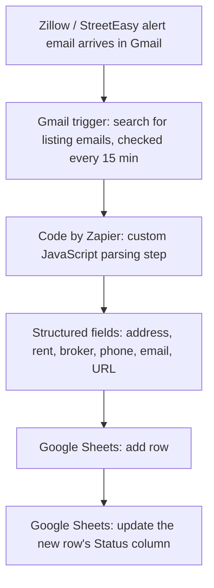

# Real Estate Lead Tracking & Listing Alert Automation

A no-code pipeline (with a custom JavaScript step) that watches Gmail for property listing emails, parses them into structured data, and logs each one as a row in Google Sheets.

Status: the Zap is currently paused (Zapier trial expired). This repo documents the build as implemented.

## The Problem

Monitoring Zillow and StreetEasy listings manually means refreshing pages, missing new listings, and losing track of leads. Hours of repetitive work with zero leverage.

## The Constraint

Neither Zillow nor StreetEasy offers a public API or a native Zapier trigger for listings. So the pipeline starts with what exists: email.

## Architecture

## Pipeline Stages

### 1. Trigger — Gmail Search
A Gmail trigger watches for incoming Zillow/StreetEasy alert emails via search query (StreetEasy and Zillow sender addresses). It polls every 15 minutes. Every matching email fires the workflow — no polling a dashboard, no manual checks.

### 2. Parsing — Custom JavaScript (Code by Zapier)
Listing emails are HTML and inconsistent. A custom JavaScript step extracts fields from the email subject and body with regex pattern-matching and normalizes them into clean, structured output. This is the most technical part of the build: the script handles messy real-world email formatting so downstream steps always receive predictable data. It is pattern-matching, not a live AI call.

Extracted fields:
- `propertyAddress`: subject with prefixes like "You've contacted", "New listing:", "Listed:", "Property:", and "You Sent a Message About" stripped, then trimmed.
- `rentAmount`: a "$X,XXX base rent" match first; otherwise the first dollar amount between $500 and $10,000 in the body.
- `brokerInfo`: broker name from "Listed by" / "Listing by" combined with phone or email; 'N/A' when nothing is found.
- `phone`: from "Call" sections first, formatted XXX-XXX-XXXX; otherwise the last valid phone-like number, with placeholder numbers filtered out.
- `email`: first body email address, excluding noreply/support/help/contact addresses.
- `listingUrl`: StreetEasy building link first, otherwise a Zillow homedetails link.

### 3. Logging — Google Sheets (Add Row + Update Row)
Parsed data lands in a Google Sheet. Every matching email adds one row; the workflow then updates that same new row's Status column.

| Parsed field | Sheet column | Notes |
|---|---|---|
| Date contacted | `Date Contacted` | From the trigger email's date |
| Property address | `Property Address` | Normalized to single-line format |
| Rent amount | `Rent Amount` | As extracted from subject or body |
| Source | `Source` | Sender name (StreetEasy / Zillow) |
| Broker name & contact | `Broker Name & Contact` | Name plus phone, or email, or N/A |
| Listing URL | `Listing URL` | Link to source listing, shown as "View Listing" |
| Status | `Status` | Set on the new row by the update step |

### 4. Current limitation — no dedup yet
The live build does not dedup on listing ID: repeat alerts for the same listing create repeat rows, because there is no lookup step and no branching. The planned next step is a lookup (match on listing ID, update the existing row, otherwise add a row) with real status values (new / updated / off_market). Until that step is built, the sheet needs periodic manual cleanup of repeats.

## Sample Payload

See `sample-payloads/listing-alert.json` for an anonymized example of the structured data the JavaScript step produces. The sample matches the step's actual output fields.

## Runbook

See `docs/runbook.md` for deployment, maintenance, and troubleshooting notes.

## Privacy Note

This repository contains **mock data only**. No real names, emails, phone numbers, or listing details are included. The sample payload uses clearly synthetic values.

## Skills Demonstrated

- No-code systems architecture (Zapier)
- Gmail as an event trigger / ingestion layer
- Custom JavaScript for regex-based data parsing and normalization (Code by Zapier)
- Google Sheets as a lightweight logging layer
- Technical documentation and runbook authoring
